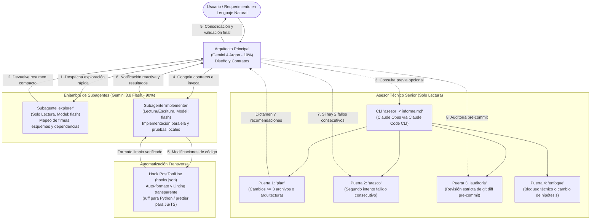

# Orquestación Multi-Agente Híbrida (Arquitectura 10/90)

Framework de orquestación multi-agente modular y de alto rendimiento para **Google Antigravity 2.0** y su interfaz de línea de comandos (**Antigravity CLI / `agy`**), complementado con asesoría técnica senior de solo lectura vía **Anthropic Claude Code CLI (`claude`)**.

---

## 1. Resumen Ejecutivo

El desarrollo asistido por modelos de lenguaje a escala se enfrenta frecuentemente a dos cuellos de botella:
1. **Saturación de contexto y degradación de razonamiento:** El modelo principal gasta tokens y atención en tareas mecánicas (explorar árboles de directorios, volcar archivos o formatear sintaxis), degradando su capacidad arquitectónica.
2. **Coste y latencia excesiva:** Asignar modelos de razonamiento profundo a tareas repetitivas o lectura masiva dispara los tiempos de respuesta y agota rápidamente las cuotas de inferencia.

Este repositorio implementa la **Arquitectura Híbrida 10/90**, diseñada para desacoplar el razonamiento estratégico de la ejecución técnica masiva:

* **10% — Arquitecto / Orquestador Principal (Gemini 4 Argon):**
  Opera en niveles de razonamiento *Medium* o *High*. Recibe los requerimientos del usuario, define la arquitectura del sistema, congela interfaces y contratos de tipos, arbitra dependencias y realiza la entrega final garantizando invariantes del proyecto.
* **90% — Subagentes de Exploración e Implementación (Gemini 3.8 Flash):**
  Despachados dinámicamente mediante la skill `hybrid-swarm` con `Model: "flash"`. Se encargan de la lectura masiva de archivos, inspección de logs y esquemas, escritura de código en paralelo y ejecución de suites de pruebas locales sin saturar la ventana de contexto del arquitecto.
* **Asesor Técnico Senior (Claude Opus vía CLI `asesor`):**
  Opera como un consultor externo de **solo lectura**, invocado en cuatro puertas de control críticas (`plan`, `atasco`, `auditoria` y `enfoque`) a través de la entrada estándar (`stdin`), garantizando análisis independiente de causas raíz y detección de regresiones.

---

## 2. Diagrama de Interacción y Flujo de Trabajo

El siguiente diagrama detalla el flujo de información, delegación y control entre los tres componentes del sistema:



---

## 3. Estructura del Repositorio

El proyecto organiza sus reglas, habilidades, flujos y utilidades bajo los estándares nativos de Google Antigravity:

```text
agent-orchestration/
├── .gitignore                      # Exclusiones locales (local/, *.env, *.bak*)
├── LICENSE                         # Licencia MIT
├── bin/
│   └── asesor                      # CLI de asesoría senior que conecta con Claude Opus
├── examples/
│   └── project-context.example.md  # Plantilla de ejemplo para contexto estático de proyecto
├── rules/
│   ├── architecture-10-90.md       # Regla transversal: rol de Argon, delegación y contexto estático
│   └── protocolo-asesor-opus.md    # Protocolo estricto de consulta a Claude Opus (4 puertas de control)
├── skills/
│   └── hybrid-swarm/
│       └── SKILL.md                # Plantillas y parámetros para define_subagent e invoke_subagent
├── workflows/
│   ├── plan-argon.md               # Workflow /plan-argon (modo manual opcional)
│   └── execute-plan.md             # Workflow /execute-plan (modo manual opcional)
├── hooks.json                      # Hook PostToolUse para formateo automático (ruff format + prettier)
├── plugin.json                     # Manifiesto de registro como plugin global de Antigravity
├── install.sh                      # Script de instalación idempotente y configurable
└── README.md                       # Documentación técnica de la arquitectura
```

### Descripción de Componentes Clave

* **[`rules/architecture-10-90.md`](rules/architecture-10-90.md)**: Define las responsabilidades y prohibiciones de consumo de cuota para Gemini 4 Argon y establece la inmutabilidad de la sección de contexto estático para preservar el prefijo de caché de tokens de entrada.
* **[`rules/protocolo-asesor-opus.md`](rules/protocolo-asesor-opus.md)**: Establece las condiciones obligatorias de consulta técnica externa, el formato del informe Markdown en `stdin` y el tratamiento crítico de sus respuestas.
* **[`skills/hybrid-swarm/SKILL.md`](skills/hybrid-swarm/SKILL.md)**: Proporciona las especificaciones JSON listas para instanciar subagentes `explorer` (`EnableWriteTools: false`, `EnableMCPTools: false`) e `implementer` (`EnableWriteTools: true`, `EnableMCPTools: false`).
* **[`workflows/plan-argon.md`](workflows/plan-argon.md)** y **[`workflows/execute-plan.md`](workflows/execute-plan.md)**: Flujos manuales opcionales para separar explícitamente el diseño de la ejecución cuando el usuario lo requiera.
* **[`bin/asesor`](bin/asesor)**: Script Bash ejecutable que encapsula la invocación de `claude -p --model opus --tools "" --strict-mcp-config --mcp-config '{"mcpServers":{}}' --no-session-persistence` desde un directorio temporal limpio, ejecutando al asesor sin herramientas locales ni servidores MCP.
* **[`hooks.json`](hooks.json)**: Intercepta eventos `PostToolUse` tras escrituras o modificaciones (`write_file`, `edit_file`) para ejecutar silenciosamente `ruff format` sobre archivos `.py` y `prettier` sobre TypeScript, JavaScript y CSS.
* **[`plugin.json`](plugin.json)**: Manifiesto que declara el plugin global `hybrid-orchestration` ante Antigravity.
* **[`install.sh`](install.sh)**: Script automatizado de despliegue que instala el plugin global en `~/.gemini/config/plugins/hybrid-orchestration`, gestiona `~/.agents/` (como copia local independiente para permitir personalización privada en `~/.agents/rules` sin ensuciar el repositorio) y configura el binario `asesor`.

---

## 4. Guía de Instalación y Despliegue Global

El repositorio incluye un script de instalación (`install.sh`) diseñado para desplegar la arquitectura en cualquier estación de trabajo Linux o macOS.

### 4.1 Principio de Funcionamiento

El instalador registra un **Plugin Global** en Antigravity (`~/.gemini/config/plugins/hybrid-orchestration`), logrando que:
1. Las reglas, skills y workflows estén disponibles de manera inmediata en **todos los workspaces y proyectos** abiertos con `agy` o Antigravity IDE, sin necesidad de duplicar archivos en cada repositorio.
2. Se preserve intacta cualquier configuración local previa del usuario en `~/.agents/`, a menos que se solicite explícitamente su actualización con `--force`.

### 4.2 Opciones de Instalación

Ejecuta el script desde la raíz del repositorio:

```bash
# 1. Instalación estándar (respeta ~/.agents existente e instala plugin global)
./install.sh

# 2. Instalación con formateo y linting automático activado (PostToolUse hook)
./install.sh --with-hooks

# 3. Instalación forzada (actualiza ~/.agents creando respaldo .bak.<timestamp>)
./install.sh --force --with-hooks

# 4. Desinstalación del plugin global
./install.sh --uninstall
```

### 4.3 Qué Realiza el Script de Instalación

1. **Gestión de `~/.agents`:**
   * Si `~/.agents/rules` ya existe y no se especifica `--force`, respeta los archivos existentes.
   * Si no existe o se pasa `--force`, genera un respaldo preventivo (`~/.agents.bak.<timestamp>`) y copia las plantillas de `rules/`, `skills/`, `workflows/` y `hooks.json`.
2. **Enlace del Plugin Global:**
   * Crea `~/.gemini/config/plugins/hybrid-orchestration/plugin.json`.
   * Enlaza simbólicamente las carpetas `rules/`, `skills/` y `workflows/` desde `~/.agents/` hacia el plugin global.
   * Si se pasa `--with-hooks`, enlaza `hooks.json` en el plugin global para activar el formateador automático.
3. **Instalación del CLI `asesor`:**
   * Copia `bin/asesor` a `~/.local/bin/asesor` y le otorga permisos de ejecución (`chmod +x`).
   * Valida que `~/.local/bin` forme parte de la variable de entorno `$PATH`.

---

## 5. Nota sobre Versiones de Modelos y Nomenclatura

En esta arquitectura, las designaciones de modelos representan roles funcionales dentro de la jerarquía de inferencia:

* **Gemini 4 Argon / Arquitecto:** Alias representativo del modelo de razonamiento profundo de Google Antigravity configurado en el nivel de pensamiento superior (`Medium` o `High`). En entornos donde el selector muestre versiones sucesivas o alternativas de razonamiento, dicho modelo asumirá el rol de diseño y orquestación.
* **Gemini 3.8 Flash / Ejecutor:** Alias del modelo optimizado para baja latencia, alto paralelismo y mínimo consumo de tokens en Antigravity (`Model: "flash"`).
* **Claude Opus / Asesor Senior:** El CLI `bin/asesor` invoca `--model opus` a través del binario de Claude Code CLI (`claude`). El modelo exacto subyacente dependerá de la versión de Opus configurada en la suscripción y versión del CLI instalado localmente.

---

## 6. Convenciones de Seguridad e Invariantes

1. **Topología de Red y Direccionamiento:**
   * Todas las referencias a redes en la documentación y configuraciones de prueba utilizan bloques reservados para documentación según **RFC 5737** (`192.0.2.0/24` TEST-NET-1 o `198.51.100.0/24` TEST-NET-2).
   * Queda estrictamente prohibido introducir direcciones IP privadas de producción o credenciales en texto plano dentro de repositorios o logs.
2. **Aislamiento del Asesor:**
   * El CLI `asesor` se invoca con `--tools "" --strict-mcp-config --mcp-config '{"mcpServers":{}}' --no-session-persistence` en un directorio temporal vacío (`mktemp -d`), deshabilitando herramientas locales y servidores MCP. El asesor no tiene facultades de ejecución en el sistema operativo, ni persistencia de sesión, ni capacidad para alterar código por sí mismo.
3. **Idempotencia y Operaciones Sensibles:**
   * Toda mutación en bases de datos o infraestructuras de almacenamiento debe diseñarse con simulación por defecto (dry-run) y requerir banderas explícitas (ej. `--apply`) precedidas de respaldos locales.
