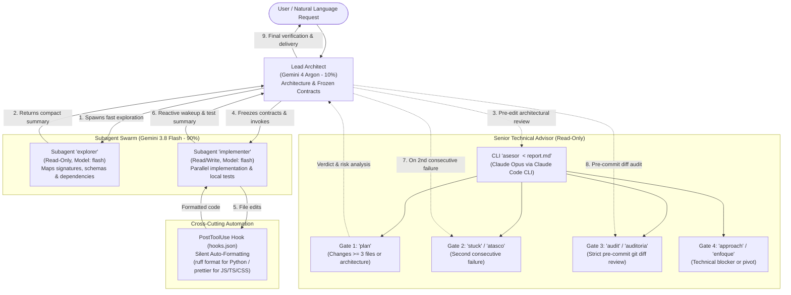

# Hybrid 10/90 Multi-Agent Orchestration Framework

A modular, high-efficiency multi-agent orchestration framework for **Google Antigravity 2.0** and its command-line interface (**Antigravity CLI / `agy`**), paired with read-only senior architectural review via **Anthropic Claude Code CLI (`claude`)**.

---

## 1. Executive Summary

Large-scale AI-assisted software engineering frequently hits two major bottlenecks:
1. **Context Window Pollution & Reasoning Degradation:** When the primary frontier model spends tokens and attention on mechanical tasks (scanning directory trees, dumping large files, or fixing formatting), its architectural focus degrades.
2. **Latency & Token Quota Exhaustion:** Using deep-reasoning models for repetitive boilerplate generation or broad codebase exploration inflates latency and rapidly burns inference quotas.

This repository implements the **Hybrid 10/90 Architecture**, decoupling high-level architectural reasoning from parallel execution:

* **10% — Lead Architect & Orchestrator (Gemini 4 Argon):**
  Operates at *Medium* or *High* reasoning effort. Receives natural-language user requests, designs system architecture, freezes type contracts and interfaces, arbitrates dependencies, and validates final deliverables against project invariants.
* **90% — Exploration & Implementation Swarm (Gemini 3.8 Flash):**
  Dynamically spawned via the `hybrid-swarm` skill with `Model: "flash"`. Handles high-volume file exploration, schema/log inspection, parallel code implementation, and local test execution without polluting the Lead Architect's context window.
* **Senior Technical Advisor (Claude Opus via `asesor` CLI):**
  Operates as a strictly **read-only** external consultant invoked at four mandatory quality gates (`plan`, `stuck`/`atasco`, `audit`/`auditoria`, and `approach`/`enfoque`) over standard input (`stdin`), providing independent root-cause analysis and pre-commit regression checks.

---

## 2. Interaction & Workflow Diagram

The following diagram illustrates the delegation flow, reactive notifications, and quality gates across all three tiers:



---

## 3. Repository Structure

The repository follows Google Antigravity's native customization layout:

```text
agent-orchestration/
├── .gitignore                      # Local exclusions (local/, scratch/, *.env, *.bak*)
├── LICENSE                         # MIT License
├── bin/
│   └── asesor                      # Senior Advisor CLI wrapper for Claude Opus
├── examples/
│   └── project-context.example.md  # Example template for static project context
├── rules/
│   ├── architecture-10-90.md       # Always-on rule: Argon role, 10/90 delegation & static context
│   └── protocolo-asesor-opus.md    # Always-on rule: Senior Advisor protocol (4 mandatory gates)
├── skills/
│   └── hybrid-swarm/
│       └── SKILL.md                # Subagent templates & parameters for define_subagent / invoke_subagent
├── workflows/
│   ├── plan-argon.md               # Optional manual workflow: /plan-argon (contract freezing)
│   └── execute-plan.md             # Optional manual workflow: /execute-plan (Flash execution)
├── hooks.json                      # PostToolUse hook for silent formatting (ruff format + prettier)
├── plugin.json                     # Global Antigravity plugin manifest
├── install.sh                      # Idempotent, configurable installation script
└── README.md                       # Technical documentation
```

### Key Components

* **[`rules/architecture-10-90.md`](rules/architecture-10-90.md)**: Defines quota boundaries for Gemini 4 Argon, automatic delegation to Flash subagents, and static prefix immutability to preserve input token cache hits.
* **[`rules/protocolo-asesor-opus.md`](rules/protocolo-asesor-opus.md)**: Enforces the four mandatory consultation gates, the required Markdown `stdin` report template, and critical evaluation of advisor feedback.
* **[`skills/hybrid-swarm/SKILL.md`](skills/hybrid-swarm/SKILL.md)**: Provides ready-to-use JSON definitions for `explorer` (`EnableWriteTools: false`, `EnableMCPTools: false`) and `implementer` (`EnableWriteTools: true`, `EnableMCPTools: false`).
* **[`workflows/plan-argon.md`](workflows/plan-argon.md)** & **[`workflows/execute-plan.md`](workflows/execute-plan.md)**: Optional manual slash-command workflows when explicit human sign-off between planning and execution is desired.
* **[`bin/asesor`](bin/asesor)**: Executable Bash wrapper that invokes `claude -p --model opus --tools "" --strict-mcp-config --mcp-config '{"mcpServers":{}}' --no-session-persistence` inside an isolated temporary directory (`mktemp -d`), disabling local tools and MCP servers. Accepts both English (`plan`, `stuck`, `audit`, `approach`) and Spanish (`plan`, `atasco`, `auditoria`, `enfoque`) gate names.
* **[`hooks.json`](hooks.json)**: Runs a `PostToolUse` handler after file write/edit operations to format `.py` files with `ruff format` and `.ts`/`.tsx`/`.js`/`.jsx`/`.css` files with `prettier`.
* **[`plugin.json`](plugin.json)**: Declares the global `hybrid-orchestration` plugin for Antigravity.
* **[`install.sh`](install.sh)**: Deploys the global plugin into `~/.gemini/config/plugins/hybrid-orchestration`, manages `~/.agents/` as an independent local directory (so private project context in `~/.agents/rules` is never overwritten unless `--force` is specified), and installs `~/.local/bin/asesor`.

---

## 4. Global Installation & Deployment Guide

The included `install.sh` script configures the orchestration framework across your entire machine on Linux or macOS.

### 4.1 How Global Discovery Works

The installer registers a **Global Plugin** in Antigravity (`~/.gemini/config/plugins/hybrid-orchestration`):
1. All rules, skills, and workflows become automatically active across **every workspace and repository** opened with `agy` or Antigravity 2.0, without duplicating files per project.
2. Any existing local configuration in `~/.agents/` is preserved intact by default, allowing you to maintain private project context in `~/.agents/rules/architecture-10-90.md` while keeping the git repository clean.

### 4.2 Installation Commands

Run from the root of the repository:

```bash
# 1. Standard install (preserves existing ~/.agents and registers global plugin)
./install.sh

# 2. Install with automatic PostToolUse code formatting enabled
./install.sh --with-hooks

# 3. Force update ~/.agents and ~/.local/bin/asesor from repo templates (creates .bak.<timestamp> backup first)
./install.sh --force --with-hooks

# 4. Uninstall the global plugin (preserves ~/.agents, ~/.local/bin/asesor, and backups)
./install.sh --uninstall
```

### 4.3 What the Installation Script Does

1. **Manages `~/.agents`:**
   * If `~/.agents/rules` already exists and `--force` is not passed, existing files are kept intact. *(Note: `--force` replaces your customized `architecture-10-90.md`, including SECTION 1; a full copy is saved to `~/.agents.bak.<timestamp>` so you can re-apply your static project context afterwards).*
   * If it does not exist or `--force` is passed, it creates a preventive backup (`~/.agents.bak.<timestamp>`) and copies the templates from `rules/`, `skills/`, `workflows/`, and `hooks.json`.
   * Filenames such as `rules/protocolo-asesor-opus.md` and `bin/asesor` are intentionally preserved so upgrades overwrite previous versions cleanly without leaving duplicate `always_on` rule files.
2. **Links the Global Plugin:**
   * Creates `~/.gemini/config/plugins/hybrid-orchestration/plugin.json`.
   * Symlinks `rules/`, `skills/`, and `workflows/` from `~/.agents/` into the global plugin directory (backing up any pre-existing non-symlink directories to `~/.gemini/config/plugins/.hybrid-orchestration-backups/`).
   * If `--with-hooks` is passed, symlinks `hooks.json` in the global plugin to enable automatic formatting; otherwise removes any previous `hooks.json` symlink.
3. **Installs the `asesor` CLI:**
   * Copies `bin/asesor` to `~/.local/bin/asesor` with executable permissions (`chmod +x`), or warns if an older version is already present without `--force`.
   * Checks whether `~/.local/bin` is in `$PATH`.

---

## 5. Note on Model Names & Versioning

Model identifiers in this framework represent functional tiers within the orchestration hierarchy:

* **Gemini 4 Argon (Lead Architect):** Representative alias for the deep-reasoning model in Google Antigravity configured at *Medium* or *High* thinking effort. In environments where the model selector displays newer or alternative reasoning versions, that model assumes the architect and orchestrator role.
* **Gemini 3.8 Flash (Swarm Executor):** Alias for Antigravity's low-latency, high-parallelism model (`Model: "flash"`).
* **Claude Opus (Senior Advisor):** `bin/asesor` invokes `--model opus` via the local Claude Code CLI (`claude`). The exact underlying model version depends on the Opus version configured in your local subscription and CLI installation.

---

## 6. Security & Operational Invariants

1. **Network Topology & Addressing (RFC 5737):**
   * All network references in documentation and example configurations use reserved documentation blocks defined in **RFC 5737** (`192.0.2.0/24` TEST-NET-1 or `198.51.100.0/24` TEST-NET-2).
   * Committing real private production IP addresses or plaintext credentials into repositories or logs is strictly prohibited.
2. **Advisor Isolation:**
   * The `asesor` CLI is invoked with `--tools "" --strict-mcp-config --mcp-config '{"mcpServers":{}}' --no-session-persistence` inside an empty temporary directory (`mktemp -d`), disabling local tools and MCP servers. The advisor has no operating-system execution privileges, no session persistence, and no ability to modify code on its own.
3. **Idempotency & Sensitive Operations:**
   * Every mutation targeting databases or storage infrastructure must default to simulation mode (`dry-run`) and require explicit flags (e.g., `--apply`) preceded by verified local backups in `backups/`.
